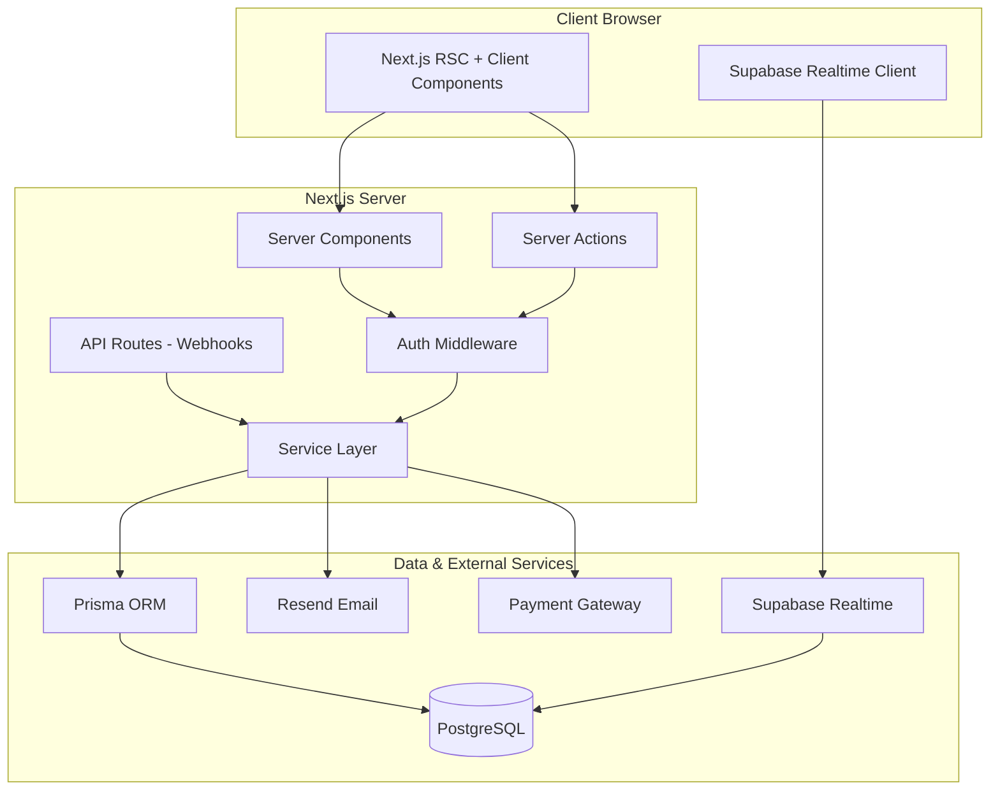
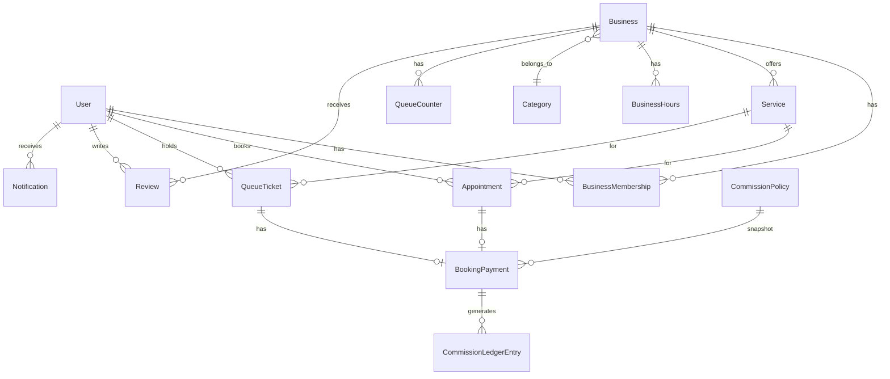

# QueueLess

> **Find your service. Book your spot. Skip the wait.**

QueueLess is a commission-based local services marketplace with a real-time virtual queue and appointment-booking system. It connects customers with local service businesses — clinics, salons, spas, diagnostic centers, repair shops, and more.


---

## Problem Statement

Customers waste hours in physical queues at local businesses. Businesses lose customers who leave due to long waits. There's no unified platform for discovering local services, booking appointments, and tracking queue positions in real time.

QueueLess solves this by providing:

- **For Customers**: Service discovery, appointment booking, walk-in queue tokens, and real-time queue tracking
- **For Business Owners**: Online listings, service management, staff and queue controls, booking analytics, and earnings reports
- **For Platform Admins**: Business verification, commission management, financial reconciliation, and moderation tools

---

## Features

### ✅ Implemented (Phase 0–1): Homepage & Static Pages

- [x] Project scaffolding with Next.js 16, TypeScript (strict), Tailwind CSS 4
- [x] shadcn/ui component library with Lucide React icons
- [x] Custom indigo/blue design system with light/dark mode support
- [x] Premium responsive homepage with 8 sections
- [x] Responsive navigation with mobile sheet menu
- [x] Hero section with search bar and popular searches
- [x] Category grid (6 categories) with hover animations
- [x] Featured business cards with ratings, queue info, verified badges
- [x] How It Works — 3-step explainer
- [x] Live Queue Preview (labelled demo)
- [x] Why Choose QueueLess — benefits grid
- [x] Business Owner CTA with commission disclosure
- [x] FAQ accordion with accurate policy content
- [x] Footer with all legal and navigation links
- [x] Category detail pages (dynamic routes)
- [x] About, Contact, Privacy, Terms, Refund Policy, Business Terms pages
- [x] Custom 404 and error pages
- [x] SEO metadata on all pages
- [x] Accessible semantic HTML
- [x] Reduced-motion support
- [x] Demo data clearly labelled as non-production

### ✅ Implemented (Phase 2): Database

- [x] PostgreSQL + Prisma 7 schema with 14 models and 8 enums
- [x] Full entity relationships (User, Business, Service, Appointment, QueueTicket, etc.)
- [x] Database seed with categories, demo users, businesses, services, hours, commission policy
- [x] Integer minor currency units (paise) for all money fields
- [x] Composite indexes for query performance

### ✅ Implemented (Phase 3): Authentication

- [x] Login form with email/password and session cookies
- [x] Registration form with Customer/Business Owner role selection
- [x] Server-side session management with 30-day expiry
- [x] Auth-aware header with user menu dropdown
- [x] Route protection middleware for /customer, /owner, /admin paths
- [x] Role-based redirects and server-side auth helpers
- [x] Logout with session cookie cleanup

### ✅ Implemented (Phase 4): Business Listings & Search

- [x] Explore page with full-text search, category/city filters, and sorting
- [x] Business card components with verified badges, ratings, queue info
- [x] Pagination component with URL-synced state
- [x] Business detail page with services, hours, reviews sidebar
- [x] Category detail pages with filtered business listings
- [x] Business registration form for owners (onboarding)
- [x] Breadcrumb navigation throughout
- [x] Graceful fallback to demo data when DB is unavailable

### ✅ Implemented (Phase 5): Booking & Queue Engine

- [x] Appointment booking service with conflict detection and business hours validation
- [x] Available time slots calculation with 15-minute intervals
- [x] Walk-in queue engine with atomic token allocation (prevents duplicates)
- [x] Queue status tracking (WAITING → CALLED → SERVING → COMPLETED)
- [x] Estimated wait time calculation
- [x] Customer bookings page with status badges and booking details
- [x] Customer queue page with token display and "called" alerts
- [x] Server actions for join queue, call next, start serving, complete ticket

### ✅ Implemented (Phase 6): Notifications

- [x] Notification service (create, fetch, mark as read)
- [x] Customer notifications page with type-specific icons
- [x] Unread count and read indicators
- [x] Notification types: queue update, appointment reminder, booking confirmation/cancellation, system

### ✅ Implemented (Phase 7): Commission & Payments

- [x] Commission calculation with integer arithmetic (no floating-point errors)
- [x] Min/max commission bounds
- [x] Booking payment creation with commission snapshot
- [x] Payment webhook endpoint (Razorpay/Stripe) with idempotency
- [x] Commission ledger entries (never modifies existing records)
- [x] Refund processing with negative ledger adjustment entries
- [x] Payment server actions for appointments and queue tickets
- [x] Commission summary for admin dashboard

### ✅ Implemented (Phase 8): Dashboards

- [x] Customer dashboard with sidebar (Bookings, Queue, Notifications)
- [x] Owner dashboard with stats overview (businesses, appointments, queue, reviews)
- [x] Owner businesses list with verification status and management links
- [x] Individual business management: today's queue, appointments, services
- [x] Owner earnings page with revenue breakdown and payment history table
- [x] Admin dashboard with platform-wide stats and commission revenue
- [x] Admin business verification page (pending/approved/rejected)
- [x] Admin commission policy management
- [x] Admin review moderation page
- [x] Admin audit log viewer with action trail

### ✅ Implemented (Phase 9): Testing, Security & Deployment

- [x] Vitest unit test suite with mocked Prisma
- [x] Commission calculation tests (core business logic)
- [x] Validation schema tests (all Zod schemas)
- [x] Booking, queue, payment, and review service tests
- [x] Rate limiter with sliding-window counter
- [x] Rate limiter unit tests
- [x] Playwright E2E test configuration (Chromium, Firefox, WebKit, Mobile)
- [x] Homepage, auth, and explore page E2E tests
- [x] Security headers (CSP, HSTS, X-Frame-Options, X-Content-Type-Options, etc.)
- [x] Rate limiting middleware on auth endpoints (brute-force protection)
- [x] Powered-by header removed (framework fingerprint)
- [x] Health check API endpoint (`/api/health`) with DB connectivity check
- [x] Multi-stage Dockerfile with non-root user and health check
- [x] `.dockerignore` for minimal image size
- [x] Standalone output mode for containerized deployments

---

## Screenshots

> Screenshots will be added as implementation progresses.

---

## Tech Stack

| Layer | Technology | Version |
|-------|-----------|---------|
| Framework | Next.js (App Router) | 16.4 |
| Language | TypeScript (strict mode) | 5.x |
| UI Library | React | 19.3 |
| Styling | Tailwind CSS | 4.x |
| Components | shadcn/ui | Latest |
| Icons | Lucide React | Latest |
| Database | PostgreSQL | 16+ (Phase 2) |
| ORM | Prisma | 7.x (Phase 2) |
| Auth | Better Auth | (Phase 3) |
| Validation | Zod | (Phase 3) |
| Forms | React Hook Form | (Phase 4) |
| Realtime | Supabase Realtime | (Phase 6) |
| Email | Resend | (Phase 6) |
| Payments | Razorpay/Stripe | (Phase 7) |
| Unit Tests | Vitest | (Phase 9) |
| E2E Tests | Playwright | (Phase 9) |
| Runtime | Node.js | 24.x |
| Package Manager | npm | 11.x |

---

## Architecture Overview



---

## Entity Relationship Diagram (Planned)



---

## Prerequisites

- **Node.js** >= 20.x (tested with 24.17.0)
- **npm** >= 10.x
- **PostgreSQL** >= 16 (required from Phase 2)

---

## Installation

```bash
# Clone the repository
git clone <repository-url>
cd queueless

# Install dependencies
npm install

# Copy environment variables
cp .env.example .env.local
# Edit .env.local with your values

# Start the development server
npm run dev
```

Visit [http://localhost:3000](http://localhost:3000)

---

## Environment Variables

See [`.env.example`](.env.example) for all variables.

| Variable | Required | Description |
|----------|----------|-------------|
| `NEXT_PUBLIC_APP_URL` | Yes | Application URL |
| `DATABASE_URL` | Phase 2+ | PostgreSQL connection string |
| `BETTER_AUTH_SECRET` | Phase 3+ | Auth session secret |
| `RESEND_API_KEY` | Phase 6+ | Email service API key |
| `RAZORPAY_KEY_ID` | Phase 7+ | Payment gateway key |
| `DEFAULT_COMMISSION_RATE_PERCENT` | Phase 7+ | Default commission (e.g., 10) |
| `DEFAULT_CURRENCY` | Phase 7+ | Currency code (e.g., INR) |

---

## Available Scripts

```bash
npm run dev              # Start development server
npm run build            # Production build
npm run start            # Start production server
npm run lint             # ESLint
npm run test             # Run unit tests (Vitest)
npm run test:watch       # Run tests in watch mode
npm run test:coverage    # Run tests with coverage report
npm run test:e2e         # Run E2E tests (Playwright)
npm run test:e2e:ui      # Run E2E tests with UI
npm run test:e2e:install # Install Playwright browsers
```

---

## Commission Model

QueueLess uses a configurable commission model:

| Item | Example |
|------|---------|
| Booking amount | ₹1,000 |
| Commission rate | 10% (configurable) |
| Platform commission | ₹100 |
| Shop owner gross share | ₹900 |
| Gateway fees & taxes | Deducted separately |

- Rates are captured as immutable snapshots at booking time
- All money stored as integer minor currency units (paise)
- Historical records are never retroactively modified
- Refunds create new ledger entries rather than editing existing ones

---

## Role & Permission Matrix

| Action | Customer | Shop Owner | Admin |
|--------|----------|------------|-------|
| Browse businesses | ✅ | ✅ | ✅ |
| Book appointments | ✅ | ❌ | ❌ |
| Join walk-in queue | ✅ | ❌ | ❌ |
| Submit reviews | ✅ | ❌ | ❌ |
| Create business listing | ❌ | ✅ | ✅ |
| Manage own business | ❌ | ✅ | ❌ |
| Manage queue | ❌ | ✅ | ❌ |
| View own earnings | ❌ | ✅ | ❌ |
| Verify businesses | ❌ | ❌ | ✅ |
| Moderate reviews | ❌ | ❌ | ✅ |
| Configure commission | ❌ | ❌ | ✅ |
| View audit logs | ❌ | ❌ | ✅ |

---

## Security Considerations

- Server-side authentication and authorization on all protected routes
- Input validation with Zod on both client and server
- Database credentials never exposed to client bundles
- Webhook signature verification for payment events
- Idempotent payment and booking operations
- Audit logging for privileged actions
- No raw card details stored
- Error responses don't leak stack traces or secrets
- Rate limiting on authentication and booking endpoints
- CSRF protection via session cookie configuration

---

## Known Limitations

- Rate limiting uses in-memory store (single-instance only; use Redis for multi-instance)
- Real-time queue updates require Supabase Realtime configuration
- Payment gateway requires live Razorpay/Stripe keys for actual transactions
- Email notifications require Resend API key configuration
- Geolocation integration is UI-only (no GPS/IP-based detection)
- Demo queue preview on homepage uses simulated data

---

## Roadmap

1. ~~**Phase 0–1**: Homepage & static pages~~ ✅
2. ~~**Phase 2**: Database schema and Prisma setup~~ ✅
3. ~~**Phase 3**: Authentication and role-based access control~~ ✅
4. ~~**Phase 4**: Business listings with search and filtering~~ ✅
5. ~~**Phase 5**: Booking engine and virtual queue system~~ ✅
6. ~~**Phase 6**: Realtime updates and notifications~~ ✅
7. ~~**Phase 7**: Commission system and payment integration~~ ✅
8. ~~**Phase 8**: Admin and owner dashboards~~ ✅
9. ~~**Phase 9**: Testing, security audit, and deployment~~ ✅

### Future Enhancements

- Redis-based rate limiting for horizontal scaling
- SMS notifications via Twilio
- Mobile app (React Native / Flutter)
- Analytics dashboard with charts
- Multi-language support (i18n)
- AI-powered queue wait time prediction

---

## Contributing

1. Fork the repository
2. Create a feature branch (`git checkout -b feature/amazing-feature`)
3. Commit your changes (`git commit -m 'Add amazing feature'`)
4. Push to the branch (`git push origin feature/amazing-feature`)
5. Open a Pull Request

Please ensure all code passes `npm run lint` and `npm run build` before submitting.

---

## License

This project is licensed under the MIT License. See [LICENSE](LICENSE) for details.
